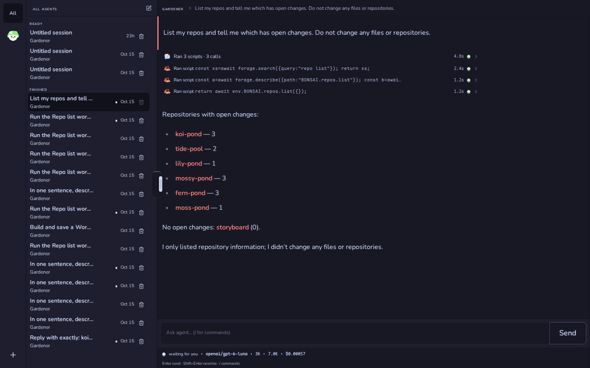
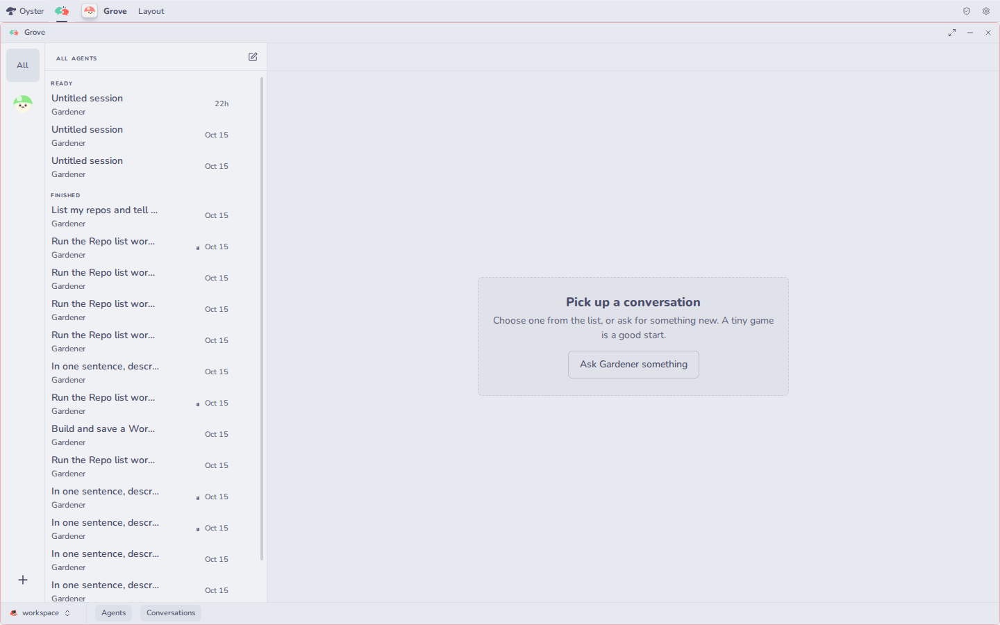

# Grove (`@fungi.computer/grove`)

Grove is where you talk to your agents: an inbox of conversations, and agents
that answer by calling your other Apps.



Grove is one of the starter Apps of
[Oyster](https://github.com/fungi-computer/oyster), the open App host that runs
on your own Cloudflare account. On Oyster, agents run on Workers AI, and every
App you install becomes a tool they can call as code, as in the picture above,
where the agent calls Bonsai's `repos.list`.

## What you can do

- Create an agent with **New Agent**, then start a conversation with it.
- Read every conversation in one inbox, grouped as **Needs you**, **Working**,
  **Finished** and **Unavailable**. The agent rail counts what needs you.
- Filter the inbox to one agent by clicking its face.
- Send a follow-up while the agent works (**Queue**), stop it (**Cancel**),
  retry a failed turn, or fork a conversation from any message.
- Watch each tool call inline, with its script, timing and result.
- Collapse the agent rail and the inbox, or drag the inbox wider. On a phone,
  **Agents and conversations** opens both as one sheet.



## Get it

Grove installs with the other starter Apps. On a deployed Oyster (see the
[Oyster quick start](https://github.com/fungi-computer/oyster#quick-start-deploy-your-own-oyster)),
run:

```sh
export OYSTER_URL=https://oyster.<your-subdomain>.workers.dev
export OYSTER_OWNER_KEY=<your owner key>
npx oyster install-apps
```

The installer clones this repository and the six others, seeds each on your
Oyster with `git push`, builds them on your Computer and installs them. Sign in
at `$OYSTER_URL/login` with the owner key; the Tourtois desktop opens with
Grove's inbox on it. Run `install-apps` again to update; each App keeps its
data.

## Change it

Every installed App is also a template you can fork on your own Oyster. Fork
Grove into a Bonsai repository and clone it with ordinary `git`:

```sh
curl -X POST -H "Authorization: Bearer $OYSTER_OWNER_KEY" -H 'content-type: application/json' \
  -d '{"appId":"app_grove","name":"my-grove"}' \
  $OYSTER_URL/apps/bonsai/methods/apps.fork
git -c http.extraHeader="Authorization: Bearer $OYSTER_OWNER_KEY" \
  clone $OYSTER_URL/git/bonsai/my-grove.git
```

The reply names your fork's App id and repository. Push your edits, open the
repository in Bonsai and choose **Settings**, then **Build & install** with that
App id and your commit as `git:<sha>`. Install the Release at `grove` to replace
the running Grove, or at a new id to keep both.

To work from GitHub instead, fork this repository and point the installer at
your forks with `--repositories <base URL>` and `--ref <branch or tag>`. The
installer reads all seven starter Apps from that base, so fork them under one
account.

## Agent tools

Agents and scripts call Grove through Oyster's MCP endpoint, or at
`POST $OYSTER_URL/apps/grove/methods/<name>` with a key; see
[Git, keys and MCP](https://github.com/fungi-computer/oyster#git-keys-and-mcp).

| Method                     | What it does                                                                                                  |
| -------------------------- | ------------------------------------------------------------------------------------------------------------- |
| `listInbox`                | Reads a page of your inbox.                                                                                   |
| `listSessions({agentId})`  | Lists one agent's conversations.                                                                              |
| `openInboxItem`            | Marks a conversation as seen and returns it.                                                                  |
| `sendMessage({..., text})` | Sends a follow-up into an existing conversation without interrupting it, up to ten a minute per conversation. |

Grove also puts its inbox on the Tourtois desktop, so you see what needs you
without opening the App.

## Build and check

Grove is a React App built with Vite. Conversations render with Parakeet and
read their state from [Shiitake](https://github.com/fungi-computer/shiitake)
sessions; controls come from [Caps](https://github.com/fungi-computer/caps).

```sh
pnpm install
pnpm build
pnpm typecheck
pnpm test
```

[src/inbox.tsx](src/inbox.tsx) owns the agent list, the inbox and the open
conversation. [src/inbox-list.tsx](src/inbox-list.tsx) draws the inbox, and
[src/conversation-opening.ts](src/conversation-opening.ts) switches
conversations without losing your draft when a read fails. The agent tools are
in [backend/methods.ts](backend/methods.ts), and [package.json](package.json)
declares the permissions the App asks for.

## License

MIT. See [LICENSE](LICENSE).

## This repository

This repository is generated from the App's directory in the Fungi monorepo
for each release. Its `@fungi.computer` dependencies are pinned to their
published versions and `pnpm-lock.yaml` resolves them from npm, so
`pnpm install --frozen-lockfile` and `pnpm build` work here, and
`oyster install-apps` builds it. The App's tests share fixtures with the
rest of the monorepo, so they run there and are not part of this repository.
